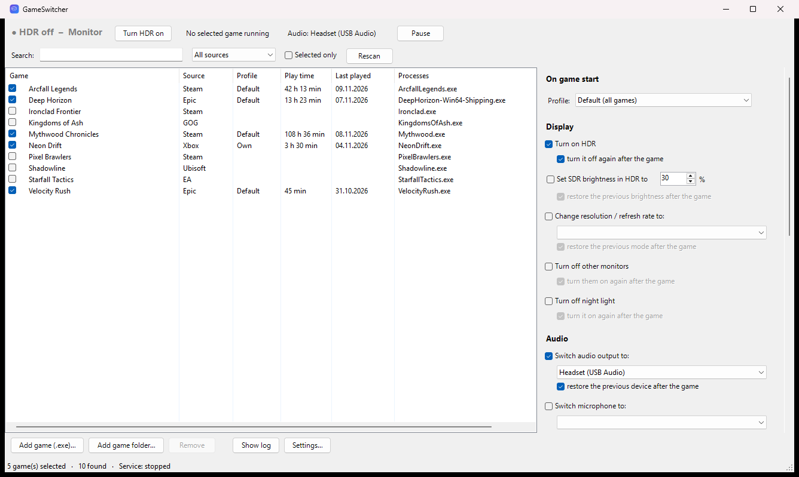
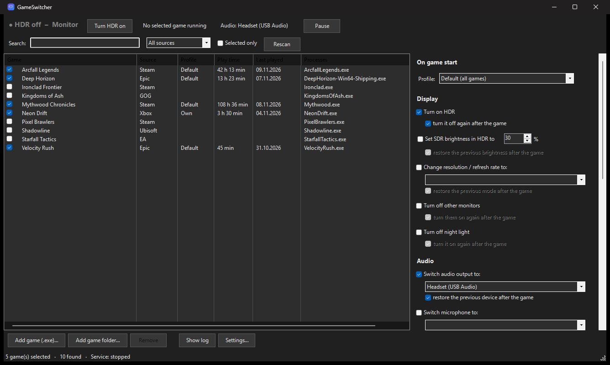

# GameSwitcher

[](https://github.com/FluffoX/GameSwitcher/actions/workflows/ci.yml) [](https://github.com/FluffoX/GameSwitcher/releases/latest) [](LICENSE)

[English](README.md) | **Deutsch**

Schaltet unter Windows 11 automatisch um, sobald du ein Spiel startest – und auf Wunsch nach dem Spielende alles wieder zurück.



## Funktionen

**Beim Spielstart (jede Aktion lässt sich danach zurücksetzen)**

| Anzeige | Audio | System | Programme |
|---|---|---|---|
| HDR an | Audioausgabe (z. B. Headset) | Energiesparplan | Programme beenden (z. B. Wallpaper Engine) |
| SDR-Helligkeit im HDR | Mikrofon | Bildschirm-Standby verhindern | Programme starten (z. B. Discord) |
| Auflösung / Bildwiederholrate | Lautstärke | | Eigene Befehle vor und nach dem Spiel |
| Weitere Monitore ausschalten | | | |
| Nachtlicht aus ¹ | | | |

**Profile pro Spiel** – ein Standardprofil für alle Spiele; jedes Spiel kann eigene Einstellungen bekommen.

**Spielerkennung**
- Installierte Spiele aus **Steam, Epic, GOG, Ubisoft, Xbox/Game Pass und EA** werden automatisch gefunden, dazu Spiele, die Windows über die Game Bar kennt. Eigene Spiele oder ganze Spieleordner lassen sich ergänzen.
- Optional reagiert GameSwitcher auf jedes Spiel, das Windows erkennt, ohne es vorher anzuhaken.
- **Tastenkürzel** (Standard Strg+Alt+G) für einen manuellen Spielmodus, z. B. für Emulatoren oder Browserspiele.
- Reagiert innerhalb von etwa einer Sekunde.

**Im Alltag**
- **Symbol im Infobereich** mit Status, Pause (1 Std., 2 Std., bis zum Neustart), HDR-Umschalter und manuellem Spielmodus.
- **Benachrichtigungen**, wenn Einstellungen übernommen und zurückgesetzt werden.
- **Spielzeit** und „Zuletzt gespielt“ pro Spiel; Spiele direkt aus der Liste starten.
- **Absturzsicher:** Jede Änderung wird sofort vermerkt und nach einem Absturz oder Stromausfall beim nächsten Start zurückgesetzt.
- **Deine Änderungen haben Vorrang:** Was du während des Spiels selbst umstellst, wird nicht zurückgesetzt.
- **12 Sprachen:** English, Deutsch, Español, Français, Italiano, Português, Polski, Türkçe, Русский, 中文（简体）, 日本語, 한국어.
- **Dark Mode**, wie Windows oder fest eingestellt.
- **Update-Prüfung** gegen die GitHub-Releases (abschaltbar).

¹ Nur auf PCs, auf denen Windows den Nachtlicht-Zustand im bekannten Format speichert; sonst wird die Option als nicht unterstützt angezeigt.

<details><summary>Dark Mode</summary>


</details>

## Installation

1. **`GameSwitcher-Setup-<version>.exe`** unter [Releases](https://github.com/FluffoX/GameSwitcher/releases/latest) herunterladen und ausführen. Administratorrechte sind nicht nötig; GameSwitcher wird nach `%LocalAppData%\Programs\GameSwitcher` installiert.
2. Beim ersten Start fragt GameSwitcher, ob es mit Windows starten soll – mit **Ja** beantworten.
3. Spiele anhaken und rechts festlegen, was beim Spielstart passieren soll. Fertig.

> Windows kann *„Der Computer wurde durch Windows geschützt“* anzeigen, weil das Programm nicht code-signiert ist. Auf **Weitere Informationen → Trotzdem ausführen** klicken.

**Update:** das Setup der neuen Version ausführen – es ersetzt die alte und behält alle Einstellungen. GameSwitcher zeigt im Fenster an, wenn eine neue Version verfügbar ist.

**Deinstallieren:** Windows-Einstellungen → Apps → GameSwitcher → Deinstallieren. Dabei werden auch Autostart und Startmenü-Eintrag entfernt. Deine Einstellungen in `%AppData%\GameSwitcher` bleiben erhalten; den Ordner einfach löschen, wenn du sie nicht mehr brauchst.

**Portabel:** lieber ohne Installation? `GameSwitcher-<version>.zip` herunterladen, beliebig entpacken und `GameSwitcher.exe` starten – die Frage nach dem Autostart kommt genauso.

Zu jedem Release gibt es die SHA-256-Prüfsummen der Dateien in `SHA256SUMS.txt`.

## Funktionsweise

Der Hintergrunddienst (`GameSwitcher.exe --watcher`, bei der Anmeldung über die Aufgabenplanung gestartet) prüft jede Sekunde, ob ein ausgewähltes Spiel läuft, wendet die Aktionen seines Profils an und setzt sie etwa 10 Sekunden nach Spielende zurück (damit Launcher-Neustarts kein Hin und Her auslösen). Der Hintergrunddienst ist in C# geschrieben und nutzt das .NET Framework 4.8, das in Windows enthalten ist – er braucht also keine zusätzliche Laufzeitumgebung und wenig Arbeitsspeicher (etwa 35 MB). Das Fenster ist PowerShell (Windows PowerShell 5.1), ausgeführt von derselben `GameSwitcher.exe` – es erscheint nie ein Konsolenfenster, und im Task-Manager steht „GameSwitcher“.

Einstellungen, Spielzeit und Protokolle liegen in `%AppData%\GameSwitcher` (`settings.json`, `playtime.json`, `watcher.log`; `state.json` nur während eines Spiels).

| Pfad | Aufgabe |
|---|---|
| `app/GameSwitcher.ps1` | Oberfläche: Spieleliste, Profile, Aktionen, Einstellungen |
| `app/Settings.ps1` | Einstellungen und Profile für die Oberfläche |
| `app/HdrControl.ps1`, `AudioControl.ps1`, `SystemControl.ps1` | Statusanzeigen und Auswahllisten der Oberfläche |
| `app/Install.ps1` | Autostart-Aufgabe und Startmenü-Eintrag (genutzt von der App und der Deinstallation) |
| `app/Strings.ps1`, `app/lang/*.json` | Übersetzungen (eine Datei pro Sprache) |
| `src/Watcher.cs` | Hintergrunddienst: Tray-Symbol, Erkennung, Tastenkürzel, Pause, Spielzeit |
| `src/GameActions.cs` | Aktionen bei Spielstart/-ende, absturzsicherer Zustand |
| `src/Native/*.cs` | HDR, SDR, Monitore (DisplayConfig), Audio (Core Audio), Anzeigemodus, Energiesparpläne, Nachtlicht |
| `src/Config.cs`, `Strings.cs`, `Paths.cs` | Einstellungen, Profile, Übersetzungen, Ordner (gemeinsam mit der Oberfläche) |
| `src/PowerShellHost.cs` | Führt die Oberfläche in `GameSwitcher.exe` aus |
| `Build.ps1` | Baut `GameSwitcher.exe` |
| `installer/GameSwitcher.iss`, `Release.ps1` | Setup (Inno Setup), portables ZIP und Prüfsummen |
| `.github/workflows/` | Prüfungen bei jedem Push; Releases baut und veröffentlicht GitHub Actions, sobald ein Versions-Tag hochgeladen wird |

### Aus dem Quellcode bauen

```powershell
powershell -ExecutionPolicy Bypass -File .\app\Install.ps1
```

baut `GameSwitcher.exe` und richtet den Autostart ein. Zum Bauen wird das [.NET SDK](https://dotnet.microsoft.com/download) benötigt (ab Version 6, nur zum Bauen – das Programm selbst läuft mit dem in Windows enthaltenen .NET Framework; Internet oder Pakete sind nicht nötig). `.\Release.ps1` baut Setup und ZIP lokal (benötigt [Inno Setup 6](https://jrsoftware.org/isinfo.php)); `.\tools\Test-Project.ps1` führt dieselben Prüfungen aus wie GitHub Actions.

### Weitere Sprache hinzufügen

`app/lang/en.json` kopieren, nach dem zweistelligen Sprachcode benennen (z. B. `nl.json`), `_name` auf den Namen der Sprache in der Sprache selbst setzen und die Texte übersetzen. Platzhalter wie `{0}` müssen erhalten bleiben. Fehlende Einträge werden automatisch auf Englisch angezeigt. Für Schriften mit eigenen Zeichen kann `_font` eine passende Windows-Schrift angeben.
## Hinweise

- Einige Funktionen nutzen undokumentierte, aber seit Langem stabile Windows-Schnittstellen: Audiogerät umschalten (`IPolicyConfig`), SDR-Helligkeit und Nachtlicht. Ändert Windows sie, funktioniert die betroffene Aktion nicht mehr; alles andere läuft weiter.
- „Weitere Monitore ausschalten“ behält den Monitor mit dem Hauptdesktop und stellt danach die zuletzt von Windows gemerkte erweiterte Anordnung wieder her.
- Wieder gestartete Programme starten ohne ihre ursprünglichen Startparameter.
- `GameSwitcher.exe` ist nicht code-signiert. Der Hintergrunddienst führt kein PowerShell mehr aus, das Fenster aber noch – bei so etwas sind manche Virenscanner vorsichtig; der vollständige Quellcode liegt in `src/` und `app/`.
- Die Update-Prüfung kontaktiert nur `api.github.com`.

## Lizenz

[MIT](LICENSE) – frei nutzbar, veränderbar und weitergebbar, solange der Lizenzhinweis erhalten bleibt.
