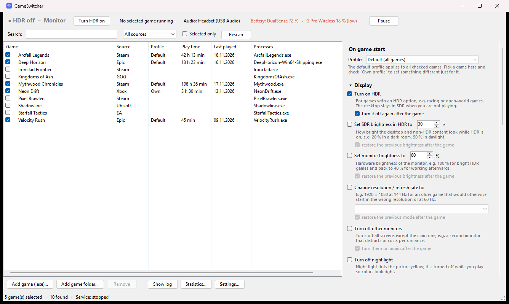
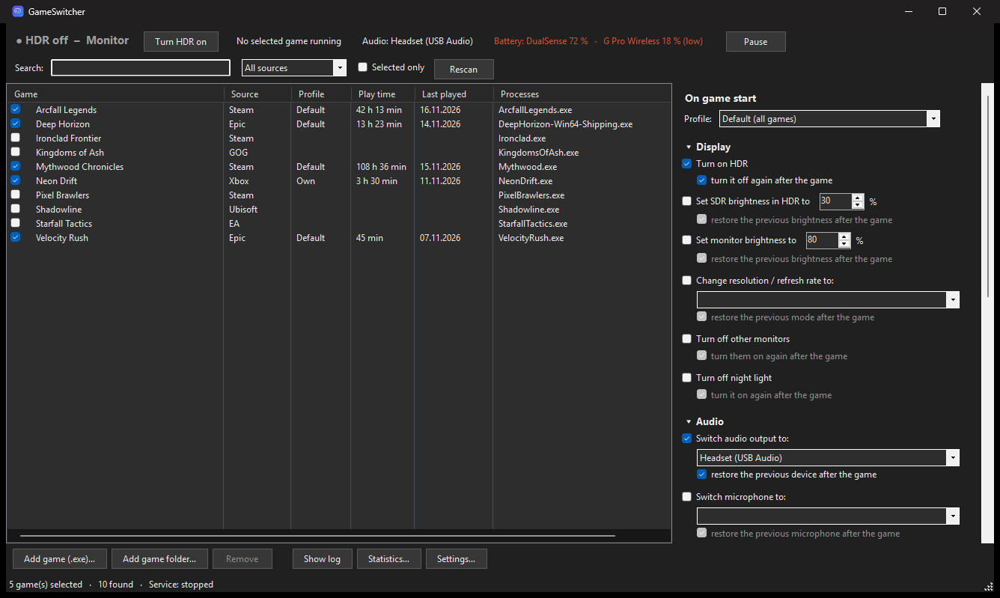
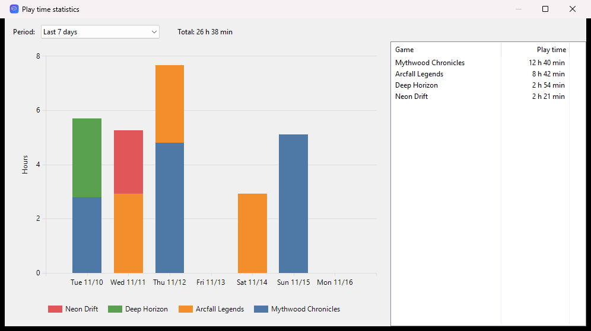

# GameSwitcher

[](https://github.com/FluffoX/GameSwitcher/actions/workflows/ci.yml) [](https://github.com/FluffoX/GameSwitcher/releases/latest) [](LICENSE)

[English](README.md) | **Deutsch**

Schaltet unter Windows 11 automatisch um, sobald du ein Spiel startest – und auf Wunsch nach dem Spielende alles wieder zurück.



## Funktionen

**Beim Spielstart (jede Aktion lässt sich danach zurücksetzen)**

| Anzeige | Audio | System | Maus und Tastatur | Programme |
|---|---|---|---|---|
| HDR an (alle oder ein gewählter Monitor) | Audioausgabe (z. B. Headset) | Energiesparplan | Zeigerbeschleunigung aus | Programme beenden (z. B. Wallpaper Engine) |
| SDR-Helligkeit im HDR | Mikrofon | Bildschirm-Standby verhindern | Zeigergeschwindigkeit | Programme starten (z. B. Discord) |
| Monitor-Helligkeit ² | Lautstärke | | Tastenkürzel der Bedienungshilfen aus (5× Umschalt) | Eigene Befehle vor und nach dem Spiel |
| Auflösung / Bildwiederholrate | | | Windows-Taste im Spiel sperren | |
| Weitere Monitore ausschalten | | | | |
| Nachtlicht aus ¹ | | | | |

**Grafik pro Spiel** (von Windows gespeichert, wie unter Einstellungen → Anzeige → Grafik): leistungsstarke Grafikkarte verwenden (bei PCs mit zwei Grafikchips) und Auto HDR für ein Spiel ein- oder ausschalten.

**Profile pro Spiel** – ein Standardprofil für alle Spiele; jedes Spiel kann eigene Einstellungen bekommen.

**Spielerkennung**
- Installierte Spiele aus **Steam, Epic, GOG, Ubisoft, Xbox/Game Pass und EA** werden automatisch gefunden, dazu Spiele, die Windows über die Game Bar kennt. Eigene Spiele oder ganze Spieleordner lassen sich ergänzen.
- Optional reagiert GameSwitcher auf jedes Spiel, das Windows erkennt, ohne es vorher anzuhaken.
- **Start über GameSwitcher:** Spiele, die aus der Liste, über **Zuletzt gespielt** im Tray-Menü oder über eine Desktop-Verknüpfung von GameSwitcher (Rechtsklick auf ein Spiel) gestartet werden, bekommen ihr Profil *vor* dem Start – wichtig für Spiele, die HDR oder die Auflösung nur beim Start prüfen. Langsame Launcher bekommen bis zu zwei Minuten Zeit.
- **Tastenkürzel** (Standard Strg+Alt+G) für einen manuellen Spielmodus, z. B. für Emulatoren oder Browserspiele.
- Reagiert innerhalb von etwa einer Sekunde.

**Im Alltag**
- **Symbol im Infobereich** mit Status, Pause (1 Std., 2 Std., bis zum Neustart), HDR-Umschalter und manuellem Spielmodus. Optional ist das Symbol selbst ein HDR-Schalter: Ein Klick schaltet HDR um, und das Symbol zeigt den Zustand (farbig mit grünem Punkt = an, grau = aus).
- **Benachrichtigungen**, wenn Einstellungen übernommen und zurückgesetzt werden.
- **Spielzeit** und „Zuletzt gespielt“ pro Spiel; Spiele direkt aus der Liste oder über **Zuletzt gespielt** im Tray-Menü starten. Nach dem Spiel zeigt eine Benachrichtigung, wie lange du gespielt hast.
- **Statistik:** Spielzeit pro Tag oder Monat für die letzten 7 Tage, 30 Tage oder 12 Monate, aufgeteilt nach Spielen.
- **Akkustände** von Controllern aller Marken (Xbox-kompatibel über XInput, PlayStation, Nintendo Switch), Logitech-Funkmäusen, -Tastaturen und -Headsets sowie allen Geräten, die ihren Akkustand auf dem Standardweg an Windows melden (HID-Akkuwert über USB oder Funkempfänger, oder Bluetooth) – im Fenster und im Tray-Menü, mit Warnung bei schwachem Akku und beim Spielstart mit schwachem Akku.
- **Couch-Modus:** Sobald ein Controller beliebiger Marke verbunden wird, auf den Fernseher umschalten (nur zweiter Bildschirm, duplizieren oder erweitern), seine Audioausgabe wählen und einen Befehl ausführen; zurückschalten, wenn der Controller ausgeschaltet wird. Solange der Couch-Modus aktiv ist, ändern Spielprofile weder Monitore, Auflösung und Helligkeit noch die Audioausgabe (abschaltbar) – die Fernseher-Einstellung bleibt also.
- **Alle Extras sind optional:** Jede dieser Funktionen lässt sich in den Einstellungen abschalten. Alles, was dein System verändert (Grafik, Helligkeit, Couch-Modus), ist aus, bis du es einschaltest.
- **Absturzsicher:** Jede Änderung wird sofort vermerkt und nach einem Absturz oder Stromausfall beim nächsten Start zurückgesetzt.
- **Deine Änderungen haben Vorrang:** Was du während des Spiels selbst umstellst, wird nicht zurückgesetzt.
- **12 Sprachen:** English, Deutsch, Español, Français, Italiano, Português, Polski, Türkçe, Русский, 中文（简体）, 日本語, 한국어.
- **Erklärungen mit Beispielen** unter den Optionen und als Tooltips (in den Einstellungen abschaltbar).
- **Dark Mode**, wie Windows oder fest eingestellt.
- **Update-Prüfung** gegen die GitHub-Releases (abschaltbar).

¹ Nur auf PCs, auf denen Windows den Nachtlicht-Zustand im bekannten Format speichert; sonst wird die Option als nicht unterstützt angezeigt.
² Externe Monitore über DDC/CI (die meisten Monitore; oft im Monitormenü einschaltbar) und eingebaute Laptop-Bildschirme.

<details><summary>Dark Mode</summary>


</details>

<details><summary>Statistik</summary>


</details>

## Installation

1. **`GameSwitcher-Setup-<version>.exe`** unter [Releases](https://github.com/FluffoX/GameSwitcher/releases/latest) herunterladen und ausführen. Administratorrechte sind nicht nötig; GameSwitcher wird nach `%LocalAppData%\Programs\GameSwitcher` installiert.
2. Beim ersten Start fragt GameSwitcher, ob es mit Windows starten soll – mit **Ja** beantworten.
3. Spiele anhaken und rechts festlegen, was beim Spielstart passieren soll. Fertig.

> Windows kann *„Der Computer wurde durch Windows geschützt“* anzeigen, weil das Programm nicht code-signiert ist. Auf **Weitere Informationen → Trotzdem ausführen** klicken.

**Update:** das Setup der neuen Version ausführen – es ersetzt die alte und behält alle Einstellungen. GameSwitcher zeigt im Fenster an, wenn eine neue Version verfügbar ist.

**Deinstallieren:** Windows-Einstellungen → Apps → GameSwitcher → Deinstallieren. Dabei werden auch Autostart und Startmenü-Eintrag entfernt. Deine Einstellungen in `%AppData%\GameSwitcher` bleiben erhalten; den Ordner einfach löschen, wenn du sie nicht mehr brauchst.

**Portabel:** lieber ohne Installation? `GameSwitcher-<version>.zip` herunterladen, beliebig entpacken und `GameSwitcher.exe` starten – die Frage nach dem Autostart kommt genauso.

Zu jedem Release gibt es die SHA-256-Prüfsummen der Dateien in `SHA256SUMS.txt`.

## Funktionsweise

Der Hintergrunddienst (`GameSwitcher.exe --watcher`, bei der Anmeldung über die Aufgabenplanung gestartet) prüft jede Sekunde, ob ein ausgewähltes Spiel läuft, wendet die Aktionen seines Profils an und setzt sie etwa 10 Sekunden nach Spielende zurück (damit Launcher-Neustarts kein Hin und Her auslösen). GameSwitcher ist in C# (WinForms) geschrieben und nutzt das .NET Framework 4.8, das in Windows 10/11 enthalten ist – es braucht also keine zusätzliche Laufzeitumgebung: Das ganze Programm ist eine einzige kleine `GameSwitcher.exe` (etwa 250 KB) plus Übersetzungen und Symbol in `app\`. Der Hintergrunddienst braucht etwa 35 MB Arbeitsspeicher.

Einstellungen, Spielzeit und Protokolle liegen in `%AppData%\GameSwitcher` (`settings.json`, `playtime.json`, `watcher.log`; `battery.json` mit den letzten Akkuständen, `graphics.json` mit den von GameSwitcher geschriebenen Grafik-Einträgen; `state.json` und `couch.json` nur während eines Spiels bzw. des Couch-Modus).

| Pfad | Aufgabe |
|---|---|
| `src/Gui/MainForm.cs` | Hauptfenster: Spieleliste, Profile, Aktionen, Status |
| `src/Gui/SettingsDialog.cs`, `StatsDialog.cs`, `ProcessPicker.cs`, `UpdateChecker.cs`, `Theme.cs` | Einstellungsfenster, Statistik, Programmauswahl, Update-Prüfung, helles/dunkles Design |
| `src/Gui/GameLibrary.cs`, `GuiSettings.cs` | Spielesuche (Steam, Epic, GOG, Ubisoft, Xbox, EA, Windows) und Speichern der Einstellungen |
| `src/Watcher.cs` | Hintergrunddienst: Tray-Symbol, Erkennung, Tastenkürzel, Pause, Spielzeit, Akkus, Couch-Modus |
| `src/GameActions.cs`, `Couch.cs`, `GraphicsSync.cs` | Aktionen bei Spielstart/-ende mit absturzsicherem Zustand, Couch-Modus, Grafik-Einstellungen pro Spiel |
| `src/Native/*.cs` | HDR, SDR, Monitore (DisplayConfig), Monitor-Helligkeit (DDC/CI, WMI), Audio (Core Audio), Anzeigemodus, Energiesparpläne, Nachtlicht, Tastenkürzel, HID-Geräte und Akkus, Grafik-Einstellungen |
| `src/Config.cs`, `Strings.cs`, `Paths.cs`, `Pause.cs`, `Autostart.cs` | Einstellungen und Profile, Übersetzungen, Ordner, Pause, Autostart und Startmenü-Eintrag |
| `app/lang/*.json`, `app/icon.ico` | Übersetzungen (eine Datei pro Sprache) und Symbol |
| `Build.ps1` | Baut `GameSwitcher.exe` |
| `installer/GameSwitcher.iss`, `Release.ps1` | Setup (Inno Setup), portables ZIP und Prüfsummen |
| `.github/workflows/` | Prüfungen bei jedem Push; Releases baut und veröffentlicht GitHub Actions, sobald ein Versions-Tag hochgeladen wird |

`GameSwitcher.exe` versteht außerdem `--watcher` (Hintergrunddienst), `--install` / `--uninstall` (Autostart und Startmenü-Eintrag), `--stop` (Dienst sauber beenden), `--launch "<Spielschlüssel>"` (Profil anwenden, dann Spiel starten; für Desktop-Verknüpfungen) und `--demo` (Beispieldaten für Screenshots).

### Aus dem Quellcode bauen

```powershell
powershell -ExecutionPolicy Bypass -File .\Build.ps1
.\GameSwitcher.exe
```

Zum Bauen wird das [.NET SDK](https://dotnet.microsoft.com/download) benötigt (ab Version 6, nur zum Bauen – das Programm selbst läuft mit dem in Windows enthaltenen .NET Framework; Internet oder Pakete sind nicht nötig). `.\Release.ps1` baut Setup und ZIP lokal (benötigt [Inno Setup 6](https://jrsoftware.org/isinfo.php)); `.\tools\Test-Project.ps1` führt dieselben Prüfungen aus wie GitHub Actions.

### Weitere Sprache hinzufügen

`app/lang/en.json` kopieren, nach dem zweistelligen Sprachcode benennen (z. B. `nl.json`), `_name` auf den Namen der Sprache in der Sprache selbst setzen und die Texte übersetzen. Platzhalter wie `{0}` müssen erhalten bleiben. Fehlende Einträge werden automatisch auf Englisch angezeigt. Für Schriften mit eigenen Zeichen kann `_font` eine passende Windows-Schrift angeben. Neue Sprachen erscheinen automatisch in den Einstellungen – ohne neu zu bauen.

## Hinweise

- Einige Funktionen nutzen undokumentierte, aber seit Langem stabile Windows-Schnittstellen: Audiogerät umschalten (`IPolicyConfig`), SDR-Helligkeit und Nachtlicht. Ändert Windows sie, funktioniert die betroffene Aktion nicht mehr; alles andere läuft weiter.
- „Weitere Monitore ausschalten“ behält den Monitor mit dem Hauptdesktop und stellt danach die zuletzt von Windows gemerkte erweiterte Anordnung wieder her.
- Wieder gestartete Programme starten ohne ihre ursprünglichen Startparameter.
- Die Sperre der Windows-Taste nutzt einen Tastatur-Hook im Hintergrunddienst und gilt nur, solange das Spielfenster im Vordergrund ist; per Alt+Tab auf dem Desktop funktioniert die Taste wieder. Maus- und Bedienungshilfen-Einstellungen sind dieselben wie in den Windows-Einstellungen und werden nach dem Spiel zurückgesetzt, sofern du sie nicht selbst geändert hast.
- Grafikkarte und Auto HDR nutzen die Programm-Einträge von Windows (`HKCU\Software\Microsoft\DirectX\UserGpuPreferences`). Windows wendet sie beim Start des Spiels an, eine Änderung wirkt also ab dem nächsten Start. GameSwitcher schreibt sie für das Hauptprogramm jedes ausgewählten Spiels und für die Programme, die es laufen sieht; beim Abwählen wird der vorherige Eintrag wiederhergestellt. Auto HDR „An“ wirkt nur, wenn Auto HDR in Windows eingeschaltet ist.
- Akkustände werden jede Minute gelesen, Logitech-Geräte nur alle fünf Minuten, weil eine Abfrage ein schlafendes Gerät aufweckt. PlayStation- und Nintendo-Controller über Bluetooth melden ihren Akku erst, nachdem ein Spiel oder Steam sie in ihren vollen Modus geschaltet hat. XInput meldet nur leer / niedrig / mittel / voll und nicht das Modell, daher heißen diese Controller Controller 1–4. Geräte mit eigenem Protokoll (z. B. Empfänger von Razer, Corsair, SteelSeries) erscheinen nur, wenn sie ihren Akkustand auch an Windows melden.
- Der Couch-Modus nutzt `DisplaySwitch.exe` (wie Win+P) und schaltet etwa 15 Sekunden nach dem letzten Controller zurück. Jeder Controller zählt – XInput (Xbox und kompatible) und jedes HID-Gamepad oder jeder Joystick. Controller, die beim Start des Dienstes schon verbunden sind, etwa ein dauerhaft angeschlossenes Lenkrad oder ein Flugsteuer, werden ignoriert, bis sie einmal getrennt wurden – sie blockieren den Couch-Modus also nicht und lösen ihn auch nicht aus.
- `GameSwitcher.exe` ist nicht code-signiert; der vollständige Quellcode liegt in `src/`.
- Die Update-Prüfung kontaktiert nur `api.github.com`.

## Lizenz

[MIT](LICENSE) – frei nutzbar, veränderbar und weitergebbar, solange der Lizenzhinweis erhalten bleibt.
