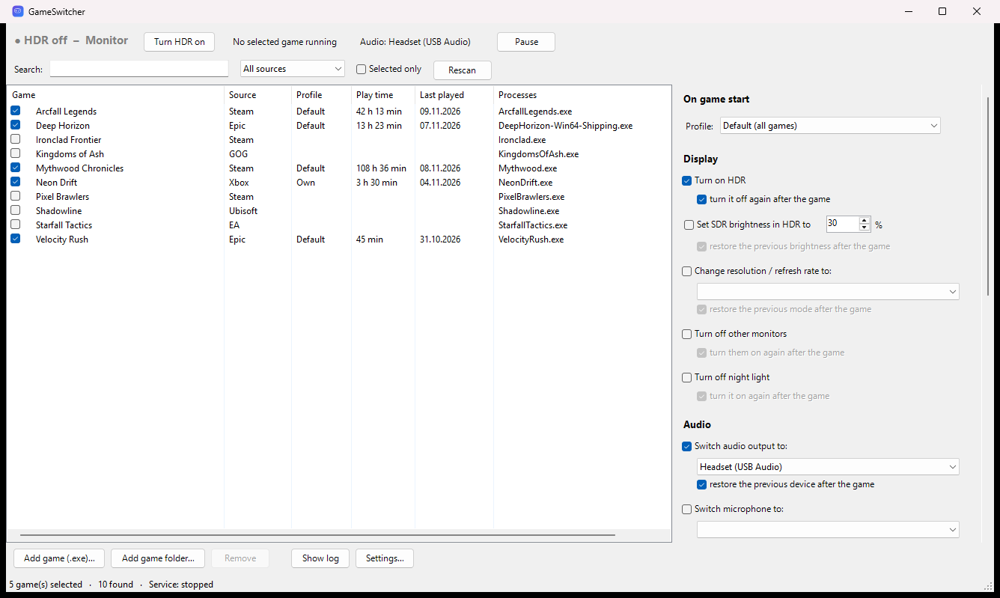
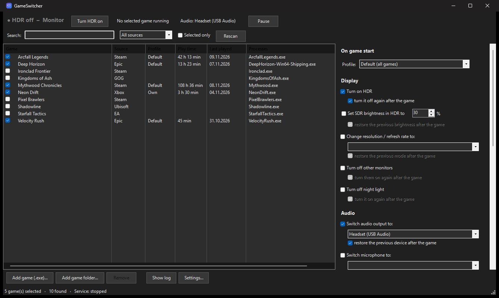

# GameSwitcher

[](https://github.com/FluffoX/GameSwitcher/actions/workflows/ci.yml) [](https://github.com/FluffoX/GameSwitcher/releases/latest) [](LICENSE)

**English** | [Deutsch](README.de.md)

Automatically switches Windows 11 settings as soon as you start a game – and, if you want, switches everything back when the game exits.



## Features

**On game start (each action can be reverted afterwards)**

| Display | Audio | System | Programs |
|---|---|---|---|
| HDR on | Audio output (e.g. headset) | Power plan | Close programs (e.g. Wallpaper Engine) |
| SDR brightness in HDR | Microphone | Prevent display standby | Start programs (e.g. Discord) |
| Resolution / refresh rate | Volume | | Custom commands before and after the game |
| Turn off other monitors | | | |
| Night light off ¹ | | | |

**Per-game profiles** – one default profile for all games; any game can get its own settings.

**Game detection**
- Installed games from **Steam, Epic, GOG, Ubisoft, Xbox/Game Pass and EA** are found automatically, plus games Windows knows from Game Bar. Custom games or whole game folders can be added.
- Optionally reacts to every game Windows recognizes, without checking it first.
- **Hotkey** (default Ctrl+Alt+G) for a manual game mode, e.g. for emulators or browser games.
- Reacts within about a second.

**Everyday use**
- **Tray icon** with status, pause (1 h, 2 h, until restart), HDR toggle and manual game mode.
- **Notifications** when settings are applied and restored.
- **Play time** and last played per game; launch games directly from the list.
- **Crash-safe:** every change is recorded right away and reverted on the next start after a crash or power loss.
- **Your manual changes win:** settings you change yourself during a game are not reset.
- **12 languages:** English, Deutsch, Español, Français, Italiano, Português, Polski, Türkçe, Русский, 中文（简体）, 日本語, 한국어.
- **Dark mode**, following Windows or set manually.
- **Update check** against GitHub releases (can be turned off).

¹ Only on PCs where Windows stores the night light state in the known format; otherwise the option is shown as unsupported.

<details><summary>Dark mode</summary>


</details>

## Installation

1. Download **`GameSwitcher-Setup-<version>.exe`** from [Releases](https://github.com/FluffoX/GameSwitcher/releases/latest) and run it. No administrator rights are needed; GameSwitcher is installed to `%LocalAppData%\Programs\GameSwitcher`.
2. On the first start GameSwitcher asks whether it should start with Windows – answer **Yes**.
3. Check your games and choose on the right what should happen when a game starts. Done.

> Windows may show *"Windows protected your PC"* because the program is not code-signed. Click **More info → Run anyway**.

**Update:** run the setup of the new version – it replaces the old one and keeps all settings. GameSwitcher tells you in its window when a new version is available.

**Uninstall:** Windows Settings → Apps → GameSwitcher → Uninstall. This also removes autostart and the Start menu entry. Your settings in `%AppData%\GameSwitcher` are kept; delete that folder if you don't need them anymore.

**Portable:** prefer no installation? Download `GameSwitcher-<version>.zip`, extract it anywhere and start `GameSwitcher.exe` – it asks about autostart the same way.

Every release lists the SHA-256 checksums of its files in `SHA256SUMS.txt`.

## How it works

The background service (`GameSwitcher.exe --watcher`, started at logon via Task Scheduler) checks every second whether a selected game is running, applies the actions of its profile and reverts them about 10 seconds after the game exits (so launcher restarts don't cause flickering). GameSwitcher is written in C# (WinForms) and targets the .NET Framework 4.8 that ships with Windows 10/11, so it needs no extra runtime: the whole program is a single small `GameSwitcher.exe` (about 120 KB) plus the translations and icon in `app\`. The background service uses about 35 MB of memory.

Settings, play time and logs are stored in `%AppData%\GameSwitcher` (`settings.json`, `playtime.json`, `watcher.log`; `state.json` only during a game).

| Path | Purpose |
|---|---|
| `src/Gui/MainForm.cs` | Main window: game list, profiles, actions, status |
| `src/Gui/SettingsDialog.cs`, `ProcessPicker.cs`, `UpdateChecker.cs`, `Theme.cs` | Settings window, program picker, update check, light/dark design |
| `src/Gui/GameLibrary.cs`, `GuiSettings.cs` | Game discovery (Steam, Epic, GOG, Ubisoft, Xbox, EA, Windows) and saving the settings |
| `src/Watcher.cs` | Background service: tray icon, detection, hotkey, pause, play time |
| `src/GameActions.cs` | Actions on game start/exit, crash-safe state |
| `src/Native/*.cs` | HDR, SDR, monitors (DisplayConfig), audio (Core Audio), display mode, power plans, night light, hotkey |
| `src/Config.cs`, `Strings.cs`, `Paths.cs`, `Pause.cs`, `Autostart.cs` | Settings and profiles, translations, folders, pause, autostart and Start menu entry |
| `app/lang/*.json`, `app/icon.ico` | Translations (one file per language) and icon |
| `Build.ps1` | Builds `GameSwitcher.exe` |
| `installer/GameSwitcher.iss`, `Release.ps1` | Setup (Inno Setup), portable ZIP and checksums |
| `.github/workflows/` | Checks on every push; releases are built and published by GitHub Actions when a version tag is pushed |

`GameSwitcher.exe` also understands `--watcher` (background service), `--install` / `--uninstall` (autostart and Start menu entry), `--stop` (stop the service cleanly) and `--demo` (sample data for screenshots).

### Building from source

```powershell
powershell -ExecutionPolicy Bypass -File .\Build.ps1
.\GameSwitcher.exe
```

Building needs the [.NET SDK](https://dotnet.microsoft.com/download) (6 or newer, only for building – the program itself runs on the .NET Framework built into Windows; no internet or packages needed). `.\Release.ps1` builds the setup and ZIP locally (needs [Inno Setup 6](https://jrsoftware.org/isinfo.php)); `.\tools\Test-Project.ps1` runs the same checks as GitHub Actions.

### Adding a language

Copy `app/lang/en.json`, name it after the two-letter language code (e.g. `nl.json`), set `_name` to the language's own name for itself and translate the texts. Placeholders such as `{0}` must be kept. Missing entries automatically fall back to English. For scripts with their own characters, `_font` can name a suitable Windows font. New languages appear in the settings automatically – no rebuild needed.

## Notes

- Some functions use undocumented but long-stable Windows interfaces: switching the audio device (`IPolicyConfig`), SDR brightness and night light. If Windows changes them, the affected action stops working; everything else keeps running.
- "Turn off other monitors" keeps the monitor showing the main desktop and afterwards restores the last extended layout Windows remembers.
- Restarted programs start without their original command-line arguments.
- `GameSwitcher.exe` is not code-signed; the full source is in `src/`.
- The update check only contacts `api.github.com`.

## License

[MIT](LICENSE) – free to use, modify and redistribute as long as the license notice is kept.
