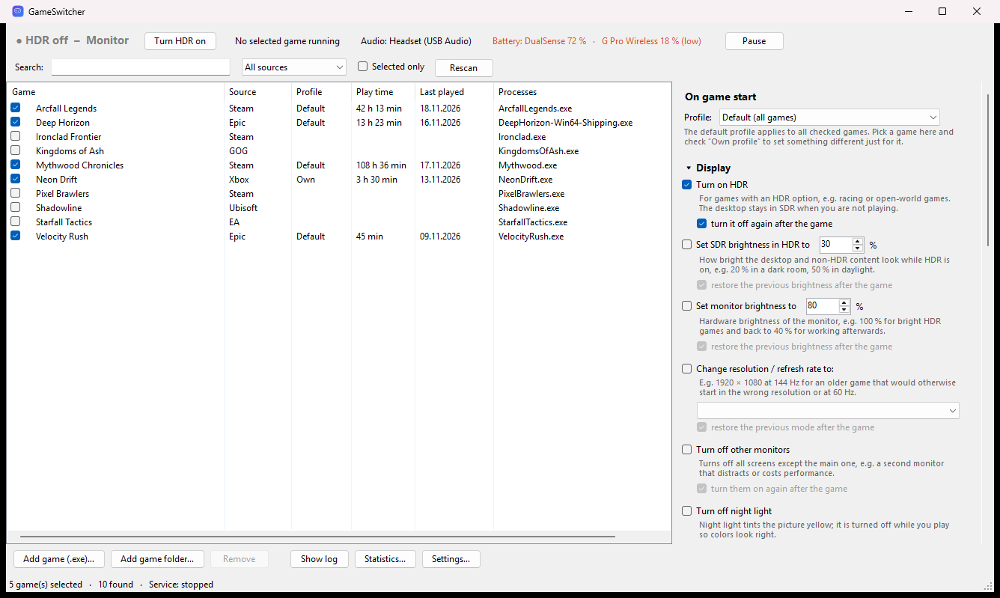
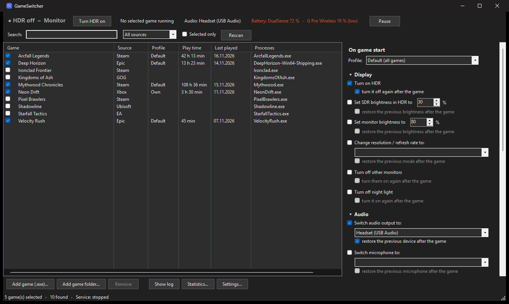
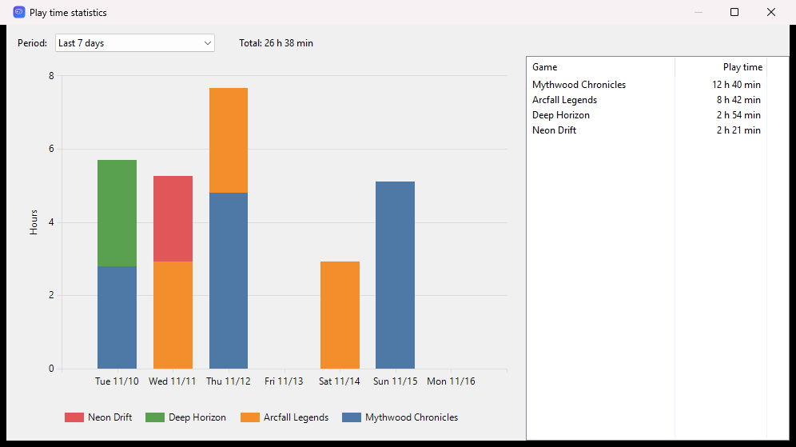

# GameSwitcher

[](https://github.com/FluffoX/GameSwitcher/actions/workflows/ci.yml) [](https://github.com/FluffoX/GameSwitcher/releases/latest) [](LICENSE)

**English** | [Deutsch](README.de.md)

Automatically switches Windows 11 settings as soon as you start a game – and, if you want, switches everything back when the game exits.



## Features

**On game start (each action can be reverted afterwards)**

| Display | Audio | System | Mouse & keyboard | Programs |
|---|---|---|---|---|
| HDR on (all or one chosen monitor) | Audio output (e.g. headset) | Power plan | Pointer acceleration off | Close programs (e.g. Wallpaper Engine) |
| SDR brightness in HDR | Microphone | Prevent display standby | Pointer speed | Start programs (e.g. Discord) |
| Monitor brightness ² | Volume | | Accessibility shortcuts off (Shift ×5) | Custom commands before and after the game |
| Resolution / refresh rate | | | Block the Windows key in the game | |
| Turn off other monitors | | | | |
| Night light off ¹ | | | | |

**Graphics per game** (stored by Windows, as in Settings → Display → Graphics): use the high-performance graphics card (for PCs with two graphics chips) and turn Auto HDR on or off for a game.

**Per-game profiles** – one default profile for all games; any game can get its own settings.

**Game detection**
- Installed games from **Steam, Epic, GOG, Ubisoft, Xbox/Game Pass and EA** are found automatically, plus games Windows knows from Game Bar. Custom games or whole game folders can be added.
- Optionally reacts to every game Windows recognizes, without checking it first.
- **Start through GameSwitcher:** games started from GameSwitcher's list, from **Recently played** in the tray menu or from a desktop shortcut it creates (right-click a game) get their profile applied *before* they start – important for games that check HDR or the resolution only at startup. The session waits up to two minutes for slow launchers.
- **Hotkey** (default Ctrl+Alt+G) for a manual game mode, e.g. for emulators or browser games.
- Reacts within about a second.

**Everyday use**
- **Tray icon** with status, pause (1 h, 2 h, until restart), HDR toggle and manual game mode. Optionally the tray icon itself is an HDR switch: a click toggles HDR, and the icon shows the state (colored with a green dot = on, gray = off).
- **Notifications** when settings are applied and restored.
- **Play time** and last played per game; launch games directly from the list or from **Recently played** in the tray menu. After a game, a notification shows how long you played.
- **Statistics:** play time per day or month for the last 7 days, 30 days or 12 months, per game.
- **Battery levels** of controllers of any brand (Xbox-compatible via XInput, PlayStation, Nintendo Switch), Logitech wireless mice, keyboards and headsets, and any device that reports its battery to Windows the standard way (HID battery value via USB or wireless receiver, or Bluetooth) – in the window and the tray menu, with a warning when a battery runs low and when you start a game with a weak battery.
- **Couch mode:** when a controller of any brand connects, switch to the TV (second screen only, duplicate or extend), its audio output and run a command; switch back when the controller is turned off. While couch mode is on, game profiles leave monitors, resolution, brightness and audio output alone (can be turned off), so the TV setup stays.
- **Everything extra is optional:** each of these functions can be turned off in the settings; anything that changes your system (graphics, brightness, couch mode) is off until you turn it on.
- **Crash-safe:** every change is recorded right away and reverted on the next start after a crash or power loss.
- **Your manual changes win:** settings you change yourself during a game are not reset.
- **12 languages:** English, Deutsch, Español, Français, Italiano, Português, Polski, Türkçe, Русский, 中文（简体）, 日本語, 한국어.
- **Explanations with examples** below the options and as tooltips (can be turned off in the settings).
- **Dark mode**, following Windows or set manually.
- **Update check** against GitHub releases (can be turned off).

¹ Only on PCs where Windows stores the night light state in the known format; otherwise the option is shown as unsupported.
² External monitors via DDC/CI (most monitors; often switchable in the monitor's menu) and built-in laptop screens.

<details><summary>Dark mode</summary>


</details>

<details><summary>Statistics</summary>


</details>

## Installation

1. Download **`GameSwitcher-Setup-<version>.exe`** from [Releases](https://github.com/FluffoX/GameSwitcher/releases/latest) and run it. No administrator rights are needed; GameSwitcher is installed to `%LocalAppData%\Programs\GameSwitcher`.
2. On the first start GameSwitcher asks whether it should start with Windows – answer **Yes**.
3. Check your games and choose on the right what should happen when a game starts. Done.

> Windows may show *"Windows protected your PC"* because the program is not code-signed. Click **More info → Run anyway**.

**Update:** run the setup of the new version – it replaces the old one and keeps all settings. GameSwitcher tells you in its window when a new version is available.

**Uninstall:** Windows Settings → Apps → GameSwitcher → Uninstall. This also removes autostart and the Start menu entry. Your settings in `%AppData%\GameSwitcher` are kept; delete that folder if you don't need them anymore.

**Portable:** prefer no installation? Download `GameSwitcher-<version>.zip` from [Releases](https://github.com/FluffoX/GameSwitcher/releases/latest) (under *Assets*), extract it anywhere and start `GameSwitcher.exe` – it asks about autostart the same way. The settings are kept in `%AppData%\GameSwitcher` here too. Autostart remembers the folder: if you move it, turn autostart off and on again in the settings.

Every release lists the SHA-256 checksums of its files in `SHA256SUMS.txt`.

## How it works

The background service (`GameSwitcher.exe --watcher`, started at logon via Task Scheduler) checks every second whether a selected game is running, applies the actions of its profile and reverts them about 10 seconds after the game exits (so launcher restarts don't cause flickering). GameSwitcher is written in C# (WinForms) and targets the .NET Framework 4.8 that ships with Windows 10/11, so it needs no extra runtime: the whole program is a single small `GameSwitcher.exe` (about 250 KB) plus the translations and icon in `app\`. The background service uses about 35 MB of memory.

Settings, play time and logs are stored in `%AppData%\GameSwitcher` (`settings.json`, `playtime.json`, `watcher.log`; `battery.json` with the last battery levels, `graphics.json` with the graphics entries GameSwitcher wrote; `state.json` and `couch.json` only while a game or couch mode is active).

| Path | Purpose |
|---|---|
| `src/Gui/MainForm.cs` | Main window: game list, profiles, actions, status |
| `src/Gui/SettingsDialog.cs`, `StatsDialog.cs`, `ProcessPicker.cs`, `UpdateChecker.cs`, `Theme.cs` | Settings window, statistics, program picker, update check, light/dark design |
| `src/Gui/GameLibrary.cs`, `GuiSettings.cs` | Game discovery (Steam, Epic, GOG, Ubisoft, Xbox, EA, Windows) and saving the settings |
| `src/Watcher.cs` | Background service: tray icon, detection, hotkey, pause, play time, batteries, couch mode |
| `src/GameActions.cs`, `Couch.cs`, `GraphicsSync.cs` | Actions on game start/exit with crash-safe state, couch mode, per-game graphics settings |
| `src/Native/*.cs` | HDR, SDR, monitors (DisplayConfig), monitor brightness (DDC/CI, WMI), audio (Core Audio), display mode, power plans, night light, hotkey, HID devices and batteries, graphics preferences |
| `src/Config.cs`, `Strings.cs`, `Paths.cs`, `Pause.cs`, `Autostart.cs` | Settings and profiles, translations, folders, pause, autostart and Start menu entry |
| `app/lang/*.json`, `app/icon.ico` | Translations (one file per language) and icon |
| `Build.ps1` | Builds `GameSwitcher.exe` |
| `installer/GameSwitcher.iss`, `Release.ps1` | Setup (Inno Setup), portable ZIP and checksums |
| `.github/workflows/` | Checks on every push; releases are built and published by GitHub Actions when a version tag is pushed |

`GameSwitcher.exe` also understands `--watcher` (background service), `--install` / `--uninstall` (autostart and Start menu entry), `--stop` (stop the service cleanly), `--launch "<game key>"` (apply the profile, then start the game; used by desktop shortcuts) and `--demo` (sample data for screenshots).

### Building from source

```powershell
powershell -ExecutionPolicy Bypass -File .\Build.ps1
.\GameSwitcher.exe
```

Building needs the [.NET SDK](https://dotnet.microsoft.com/download) (6 or newer, only for building – the program itself runs on the .NET Framework built into Windows; no internet or packages needed). `.\Release.ps1` builds the setup and ZIP locally (needs [Inno Setup 6](https://jrsoftware.org/isinfo.php)); `.\tools\Test-Project.ps1` runs the same checks as GitHub Actions.

### Adding a language

Copy `app/lang/en.json`, name it after the two-letter language code (e.g. `nl.json`), set `_name` to the language's own name for itself and translate the texts. Placeholders such as `{0}` must be kept. Missing entries automatically fall back to English. For scripts with their own characters, `_font` can name a suitable Windows font. New languages appear in the settings automatically – no rebuild needed.

## Notes

- Some functions use undocumented but long-stable Windows interfaces: switching the audio device (`IPolicyConfig`), SDR brightness and night light. If Windows changes them, the affected action stops working; everything else keeps running.
- "Turn off other monitors" keeps the monitor showing the main desktop and afterwards restores the last extended layout Windows remembers.
- Restarted programs start without their original command-line arguments.
- Blocking the Windows key uses a keyboard hook in the background service and only applies while the game's window is in the foreground; Alt+Tab to the desktop and the key works again. Mouse and accessibility settings are the same as in Windows Settings and are restored after the game unless you changed them yourself.
- Graphics card and Auto HDR use the per-program entries of Windows (`HKCU\Software\Microsoft\DirectX\UserGpuPreferences`). Windows applies them when the game starts, so a change takes effect from the next start. GameSwitcher writes them for the main program of each selected game and for the programs it sees running; turning the option off restores what was there before. Auto HDR "on" only has an effect while Auto HDR is turned on in Windows.
- Battery levels are read every minute; Logitech devices only every five minutes, because asking a sleeping device wakes it up. PlayStation and Nintendo controllers connected via Bluetooth report their battery only once a game or Steam has switched them to their full mode. XInput only tells empty / low / medium / full, and not the model, so these controllers are shown as Controller 1–4. Devices with their own protocols (e.g. Razer, Corsair, SteelSeries receivers) are only shown if they also report their battery to Windows.
- Couch mode uses `DisplaySwitch.exe` (like Win+P) and switches back about 15 seconds after the last controller is gone. Any controller counts – XInput (Xbox and compatible) and every HID gamepad or joystick. Controllers that are already connected when the service starts, such as a steering wheel or flight stick that is always plugged in, are ignored until they have been disconnected once, so they never block or trigger couch mode.
- `GameSwitcher.exe` is not code-signed; the full source is in `src/`.
- The update check only contacts `api.github.com`.

## License

[MIT](LICENSE) – free to use, modify and redistribute as long as the license notice is kept.
